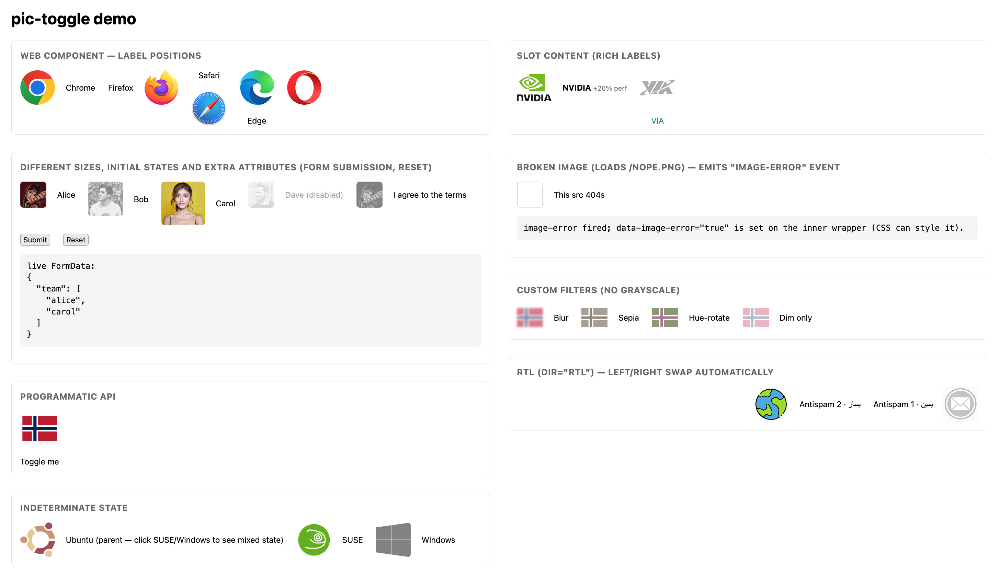

# pictoggle

[](https://www.npmjs.com/package/pictoggle)
[](https://www.npmjs.com/package/pictoggle)
[](https://bundlephobia.com/package/pictoggle)
[](./package.json)
[](https://github.com/Insider515/pictoggle/actions)
[](./LICENSE)

> Image checkboxes that behave like real `<input type="checkbox">`.

Any PNG, SVG, WebP, GIF or AVIF becomes a toggle control. The checked image is in full colour, the unchecked one is grayscale (or any filter you prefer). Zero runtime dependencies, no build step, no framework lock-in.

**→ Live demo: https://insider515.github.io/pictoggle/**
**→ npm package: https://www.npmjs.com/package/pictoggle** (install with `npm install pictoggle`)



## Table of contents

- [Why pictoggle?](#why-pictoggle)
- [Install](#install)
- [Quick start](#quick-start)
  - [HTML](#html)
  - [JavaScript](#javascript)
- [Form integration](#form-integration)
- [HTML attributes](#html-attributes)
- [JavaScript API](#javascript-api)
  - [Properties](#properties-htmlinputelement-parity)
  - [Methods](#methods)
  - [`createPicToggle()`](#createpictoggleoptions)
- [Events](#events)
- [Styling](#styling)
  - [Custom properties](#custom-properties)
  - [Data attributes for state styling](#data-attributes-for-state-styling)
  - [Automatic adaptations](#automatic-adaptations)
- [Slot content](#slot-content-rich-labels)
- [Accessibility](#accessibility)
- [Framework integration](#framework-integration)
  - [React](#react)
  - [Vue](#vue)
  - [Angular](#angular)
  - [Svelte](#svelte)
- [Browser support](#browser-support)
- [Server-side rendering](#server-side-rendering)
- [Running the demo](#running-the-demo)
- [Testing](#testing)
- [Development](#development)
- [Changelog](#changelog)
- [License](#license)

## Why pictoggle?

Common ways to build an "image checkbox" fall short:

| Approach | Problem |
|---|---|
| CSS `background-image` on a styled `<input>` | Hard to re-colour PNG; `appearance: none` loses accessibility hooks. |
| Framework component (React/Vue/…) | Locks you into one framework; weight; another dependency. |
| Hiding `<input>` and clicking a `<label>` with an image | Hover/focus/disabled must be re-implemented in CSS, every time. |

`pictoggle` is one 30 KB file that solves all of this:

- The `<pic-toggle>` element is a **form-associated custom element**. Browsers see it as a real form control: `FormData` picks it up, `required` validation works, `form.reset()` restores it, back/forward restores it, `<fieldset disabled>` cascades into it.
- The image is a plain `` whose colour is controlled by one CSS filter. PNG, SVG, WebP, GIF and AVIF all behave identically.
- No build step, no framework. Drop it on a page with a `<script type="module">`, or import it from any framework.
- Full `HTMLInputElement`-style surface: `.checked`, `.indeterminate`, `.required`, `.validity`, `.labels`, `.checkValidity()`, `.reportValidity()`, `.setCustomValidity()`, and so on.
- Fallback for browsers without `ElementInternals` (Safari < 16.4): a hidden `<input>` keeps form submission working.

## Install

```bash
npm install pictoggle
```

Or copy [`src/pictoggle.js`](./src/pictoggle.js) into your project. The file is self-contained.

A CDN build works out of the box:

```html
<script type="module" src="https://unpkg.com/pictoggle"></script>
```

## Quick start

### HTML

```html
<script type="module">
  import 'pictoggle';
</script>

<form action="/save" method="post">
  <pic-toggle src="/icons/https.svg"  label="HTTPS"  name="features" value="https"  checked></pic-toggle>
  <pic-toggle src="/icons/socks5.svg" label="SOCKS5" name="features" value="socks5"></pic-toggle>
  <pic-toggle src="/icons/tos.svg"    label="I agree to the terms" name="agree" value="yes" required></pic-toggle>

  <button type="submit">Save</button>
</form>
```

On submit, the form body is `features=https&features=socks5&agree=yes` — exactly what equivalent native checkboxes would send.

### JavaScript

```js
import { createPicToggle } from 'pictoggle';

const control = createPicToggle({
  src: '/icons/https.png',
  label: 'HTTPS',
  labelPosition: 'bottom',           // left | right | top | bottom | none
  size: 64,                          // px number OR any CSS length ('3rem', 'clamp(32px, 10vw, 96px)', …)
  checked: false,
  indeterminate: false,
  disabled: false,
  attributes: {                      // extra DOM attributes
    name: 'features',
    value: 'https',
    'data-tier': 'pro',
    title: 'Secure HTTPS proxy',
  },
  onChange: (checked, event) => console.log('checked:', checked),
  onError:  (event) => console.warn('image failed to load'),
});

document.body.appendChild(control);
```

The returned element is a `<label class="pic-toggle">` with a real inner `<input type="checkbox">`. It participates in `<form>` submission natively.

## Form integration

| Feature | How it works |
|---|---|
| **`FormData(form)` sees the value** | `<pic-toggle>` is a form-associated custom element (uses `ElementInternals.setFormValue`). The `createPicToggle()` form uses a real `<input type="checkbox">` in light DOM. |
| **`name` / `value`** | HTML attributes on the tag. Unchecked = nothing submitted (native semantics). Default `value` is `"on"`. |
| **`required`** | Sets `:invalid`, fills `ValidityState.valueMissing`, blocks `form.submit()`, triggers the browser's native "please check this box" bubble. |
| **`form.reset()`** | Returns each control to the `checked` attribute it had in markup. |
| **`<fieldset disabled>`** | Propagates `disabled` to every `<pic-toggle>` inside automatically. |
| **Back / forward** | State is restored by the browser (`formStateRestoreCallback`). |
| **Native `.form`, `.labels`, `.validity`, …** | Exposed on the host element. See [API](#properties-htmlinputelement-parity). |

### Required validation

```html
<form id="prefs">
  <pic-toggle src="/icons/tos.svg" label="I agree" name="agree" value="yes" required></pic-toggle>
  <button type="submit">Continue</button>
</form>

<script>
  document.getElementById('prefs').addEventListener('submit', (e) => {
    if (!e.target.checkValidity()) {
      e.preventDefault();
      e.target.reportValidity();   // native "please check this box" bubble
    }
  });
</script>
```

## HTML attributes

| Attribute | Type | Default | Description |
|---|---|---|---|
| `src` | string | required | Image URL (PNG, SVG, WebP, GIF, AVIF). |
| `alt` | string | `label` or `""` | Image alt text (a11y). |
| `label` | string | `""` | Text next to the image. Ignored when the default `<slot>` has content. |
| `label-position` | enum | `right` | One of `left`, `right`, `top`, `bottom`, `none`. |
| `size` | CSS length or integer | `48` | Image size. `size="48"` means `48px`; `size="3rem"` means `3rem`. |
| `checked` | boolean | — | Initial checked state (`defaultChecked`). |
| `indeterminate` | boolean | — | Initial indeterminate state. |
| `disabled` | boolean | — | Disables the control. |
| `required` | boolean | — | Required for form submission. |
| `name`, `value`, `form` | string | — | Standard form-control attributes. |

Any additional attribute (`data-*`, `aria-*`, `title`, `id`, `tabindex`, …) stays on the host and is yours.

## JavaScript API

### Properties (HTMLInputElement parity)

| Property | Type | Notes |
|---|---|---|
| `.checked` | `boolean` | Live state. Assigning it does **not** rewrite the HTML attribute (matches native). |
| `.defaultChecked` | `boolean` | Mirrors the HTML `checked` attribute. Used by `form.reset()`. |
| `.indeterminate` | `boolean` | Mixed state; `aria-checked="mixed"`. Cleared automatically when `.checked` changes. |
| `.disabled` | `boolean` | Reflects / updates the `disabled` attribute. |
| `.required` | `boolean` | Reflects / updates the `required` attribute. |
| `.name` | `string` | Reflects / updates the `name` attribute. |
| `.value` | `string` | Reflects / updates the `value` attribute. Default `"on"`. |
| `.type` | `'checkbox'` | Always. |
| `.form` | `HTMLFormElement \| null` | Owning `<form>`. |
| `.labels` | `NodeList \| null` | `<label>` elements associated with the control. |
| `.validity` | `ValidityState` | Standard. |
| `.validationMessage` | `string` | Standard. |
| `.willValidate` | `boolean` | Standard. |
| `.imageError` | `boolean` | `true` if the current `src` failed to load. |

### Methods

| Method | Description |
|---|---|
| `checkValidity()` | Standard. Returns `true` if valid. |
| `reportValidity()` | Standard. Shows the native invalid bubble if invalid. |
| `setCustomValidity(message)` | Standard. Empty string clears the custom error. |

### `createPicToggle(options)`

Builds a `<label class="pic-toggle">` and returns it with helper methods attached. All options are optional except `src`.

| Option | Type | Default | Description |
|---|---|---|---|
| `src` | string | — | Image URL. |
| `alt` | string | `label` | Alt text. |
| `label` | string | `""` | Text label. |
| `labelPosition` | `'left' \| 'right' \| 'top' \| 'bottom' \| 'none'` | `'right'` | Where the label sits. |
| `size` | number \| CSS length | `48px` | Image size. |
| `checked` | boolean | `false` | Initial state. |
| `indeterminate` | boolean | `false` | Initial state. |
| `disabled` | boolean | `false` | Initial state. |
| `attributes` | `Record<string, string \| number \| boolean>` | — | Extra DOM attributes. `name`, `value`, `form`, `required`, `autofocus`, `tabindex` land on the inner `<input>`; the rest on the wrapper. |
| `onChange` | `(checked, event?) => void` | — | Fires on an actual state change. Second arg is the DOM `Event` on user interaction, `undefined` on programmatic calls. |
| `onIndeterminate` | `(indeterminate) => void` | — | Fires on indeterminate changes. |
| `onError` | `(event) => void` | — | Fires when the image fails to load. |
| `ownerDocument` | `Document` | `document` | Target document (useful for `<iframe>`). |

Returned element helpers:

```js
control.getChecked();            // → boolean
control.getIndeterminate();      // → boolean
control.getImageError();         // → boolean
control.setChecked(true);        // optionally { silent: true } to suppress onChange
control.setIndeterminate(true);
control.toggle();
control.setDisabled(true);
control.setSize('3rem');
control.setLabel('New label');
control.setLabelPosition('left');
control.setSrc('/new.png');
control.setAlt('…');
control.setOnChange(cb);
control.setOnError(cb);
control.setOnIndeterminate(cb);
control.destroy();               // removes listeners and the element
```

## Events

| Event | When | Detail |
|---|---|---|
| `change` | After a user interaction toggles the control. Fires only on an actual state transition — matches native. | — |
| `input` | Together with `change`, before it. | — |
| `image-error` | The image failed to load. | `{ event: Event }` |

Programmatic `.checked = x` does **not** fire events (matches native). To force one, dispatch it yourself:

```js
el.checked = true;
el.dispatchEvent(new Event('change', { bubbles: true }));
```

## Styling

### Custom properties

Every token has a sensible default. Override any of them on any ancestor — a parent class, `:root`, or the element itself.

| Variable | Default | What it controls |
|---|---|---|
| `--pt-size` | `48px` | Image box width and height. |
| `--pt-gap` | `10px` | Space between image and label. |
| `--pt-radius` | `6px` | Image border-radius. |
| `--pt-active-opacity` | `1` | Opacity when checked. |
| `--pt-inactive-opacity` | `0.55` | Opacity when unchecked. |
| `--pt-hover-opacity` | `0.8` | Opacity when hovering an unchecked control. |
| `--pt-active-filter` | `none` | CSS `filter` when checked. |
| `--pt-inactive-filter` | `grayscale(1)` | CSS `filter` when unchecked. |
| `--pt-indeterminate-filter` | `grayscale(0.5)` | CSS `filter` for the mixed state. |
| `--pt-indeterminate-opacity` | `0.75` | Opacity for the mixed state. |
| `--pt-focus-ring` | `2px solid #4c9ffe` | Keyboard focus outline. |
| `--pt-focus-ring-offset` | `2px` | Focus outline offset. |
| `--pt-transition` | `150ms ease` | Transition for filter and opacity. |

Example — replace the grayscale default with a soft blur:

```css
pic-toggle {
  --pt-inactive-filter: blur(1px) opacity(0.7);
  --pt-active-filter: drop-shadow(0 0 4px #0005);
}
```

### Data attributes for state styling

The internal `<label>` carries `data-*` attributes you can target in CSS:

| Attribute | Present when |
|---|---|
| `[data-checked="true"]` | The control is checked. |
| `[data-indeterminate="true"]` | The control is indeterminate. |
| `[data-disabled="true"]` | The control is disabled. |
| `[data-image-error="true"]` | The image failed to load. |
| `[data-position="…"]` | `left` / `right` / `top` / `bottom` / `none`. |

> **Important**: use `pic-toggle[aria-checked="true"]`, not `pic-toggle[checked]`, when styling the live state of the Web Component. The HTML `checked` attribute records the **initial** value (`defaultChecked`), exactly like native `<input type="checkbox">`.

### Automatic adaptations

- **RTL** — layout uses logical margins. Set `dir="rtl"` on an ancestor; left/right positions swap automatically.
- **Reduced motion** — `@media (prefers-reduced-motion: reduce)` disables the colour transition.
- **Print** — `@media print` restores the image colour so printouts stay legible.
- **Forced colours** — `@media (forced-colors: active)` falls back to `Highlight` / `CanvasText` so Windows High Contrast is respected.

## Slot content (rich labels)

Need more than a text label? Use the default slot. Its presence overrides the `label` attribute.

```html
<pic-toggle src="/icons/vip.svg" name="tier" value="vip">
  <strong>VIP</strong>
  <small style="opacity:0.7">+20% off</small>
</pic-toggle>
```

## Accessibility

- Host has `role="checkbox"` and `tabindex="0"` (unless an explicit `tabindex` is set).
- `aria-checked` is kept in sync and reports `"mixed"` for the indeterminate state.
- `aria-disabled` and `aria-required` reflect the respective properties.
- `ElementInternals.ariaChecked` / `ariaDisabled` / `ariaRequired` are populated too, so assistive technology that reads them (newer screen readers) gets the state without walking the attribute surface.
- Keyboard: `Space` toggles. `Enter` does **not** toggle — exactly like a native checkbox (Enter submits the form).
- Focus ring appears only on keyboard navigation (`:focus-visible`), never on mouse clicks.

## Framework integration

`<pic-toggle>` is a standard custom element — it works wherever HTML works.

### React

React 19+ supports custom elements natively (property binding, event listeners, boolean attributes).

```tsx
import 'pictoggle';
import type { PicToggleElement } from 'pictoggle';

export function Features() {
  return (
    <pic-toggle
      src="/icons/https.svg"
      label="HTTPS"
      name="features"
      value="https"
      checked
      onChange={(e) => console.log((e.target as PicToggleElement).checked)}
    />
  );
}
```

The package already augments `JSX.IntrinsicElements`, so no extra module declaration is needed.

For React 18 and earlier, wrap once:

```tsx
import { useEffect, useRef } from 'react';
import 'pictoggle';
import type { PicToggleElement } from 'pictoggle';

export function PicToggle(props: {
  src: string; label?: string; checked?: boolean;
  onChange?: (checked: boolean) => void;
}) {
  const ref = useRef<PicToggleElement>(null);
  useEffect(() => {
    const el = ref.current!;
    const handler = () => props.onChange?.(el.checked);
    el.addEventListener('change', handler);
    return () => el.removeEventListener('change', handler);
  }, [props.onChange]);
  return <pic-toggle ref={ref} src={props.src} label={props.label} {...(props.checked ? { checked: '' } : {})} />;
}
```

### Vue

Mark the tag as a custom element in your build config:

```js
// vite.config.js
export default {
  plugins: [
    vue({
      template: { compilerOptions: { isCustomElement: (tag) => tag === 'pic-toggle' } },
    }),
  ],
};
```

Then use it as normal:

```vue
<template>
  <pic-toggle
    src="/icons/https.svg"
    label="HTTPS"
    :checked="isOn || null"
    @change="isOn = $event.target.checked"
  />
</template>

<script setup>
import { ref } from 'vue';
import 'pictoggle';
const isOn = ref(false);
</script>
```

### Angular

Add `CUSTOM_ELEMENTS_SCHEMA` to the module and import the package once in your bootstrap:

```ts
import 'pictoggle';
import { NgModule, CUSTOM_ELEMENTS_SCHEMA } from '@angular/core';

@NgModule({ schemas: [CUSTOM_ELEMENTS_SCHEMA] })
export class AppModule {}
```

```html
<pic-toggle src="/icons/https.svg" label="HTTPS" [attr.checked]="isOn ? '' : null"
            (change)="isOn = $event.target.checked"></pic-toggle>
```

### Svelte

Nothing special required.

```svelte
<script>
  import 'pictoggle';
  let isOn = false;
</script>

<pic-toggle src="/icons/https.svg" label="HTTPS"
            checked={isOn || null}
            on:change={(e) => (isOn = e.target.checked)} />
```

## Browser support

| Feature | Chrome | Edge | Firefox | Safari |
|---|---:|---:|---:|---:|
| `createPicToggle()` programmatic API | 60 | 79 | 55 | 11.1 |
| `<pic-toggle>` custom element (visuals + a11y) | 67 | 79 | 63 | 10.1 |
| `<pic-toggle>` form association (`ElementInternals`) | 77 | 79 | 93 | **16.4** |

On Safari < 16.4 the custom element falls back to a hidden `<input type="checkbox">` in light DOM — form submission continues to work, but `.validity` / `.checkValidity()` operate on that hidden input instead of the host.

## Server-side rendering

`pictoggle` is import-safe in Node (no top-level DOM access). The custom element only registers itself when `window.customElements` is defined, so SSR frameworks (Next.js, Nuxt, SvelteKit, …) can import the module from either side without crashing. The real rendering happens client-side after hydration.

For SSR output, write the markup as plain HTML:

```html
<pic-toggle src="/icons/https.svg" label="HTTPS" name="features" value="https" checked></pic-toggle>
```

It will light up when the module loads on the client.

## Running the demo

```bash
git clone https://github.com/Insider515/pictoggle.git
cd pictoggle
python3 -m http.server 8080
# open http://localhost:8080/examples/
```

Or with Node:

```bash
npx http-server . -p 8080
```

The demo covers every feature: all label positions, indeterminate tri-state, form submission with reset and required, rich slot content, broken-image handling, custom filters and RTL.

## Testing

```bash
npm run test:unit       # pure-Node DOM-stub tests (fast)
npm run test:browser    # headless Chrome integration tests (skipped if Chrome not installed)
npm test                # both
```

The integration suite does not require Playwright or Puppeteer — it drives Google Chrome's headless mode directly. Set `CHROME_BIN` to point at a specific binary, or omit it to use the first found of Chrome, Chromium or Edge.

## Development

See [CONTRIBUTING.md](./CONTRIBUTING.md).

Short version:

- Single-file module: [`src/pictoggle.js`](./src/pictoggle.js).
- No build step, no bundler, no transpiler. The file published to npm is the file you edit.
- Public types in [`src/pictoggle.d.ts`](./src/pictoggle.d.ts).
- Every bug fix lands with a regression test.
- Node ≥ 18 required for the test runner.

## Changelog

See [CHANGELOG.md](./CHANGELOG.md).

## License

[MIT](./LICENSE) © pictoggle contributors
